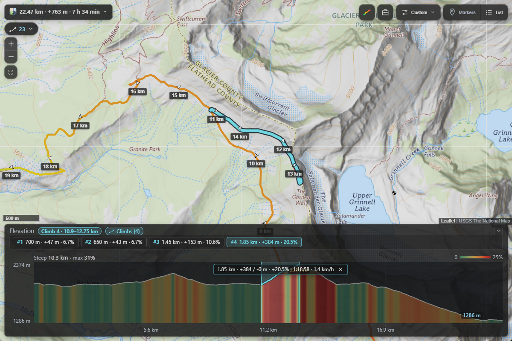
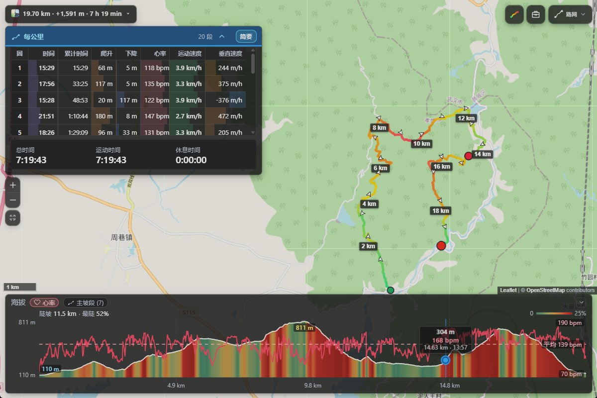
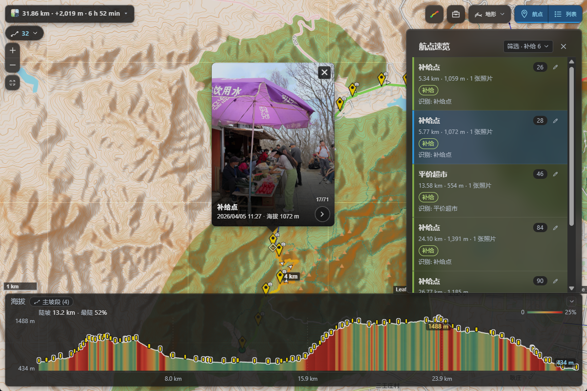
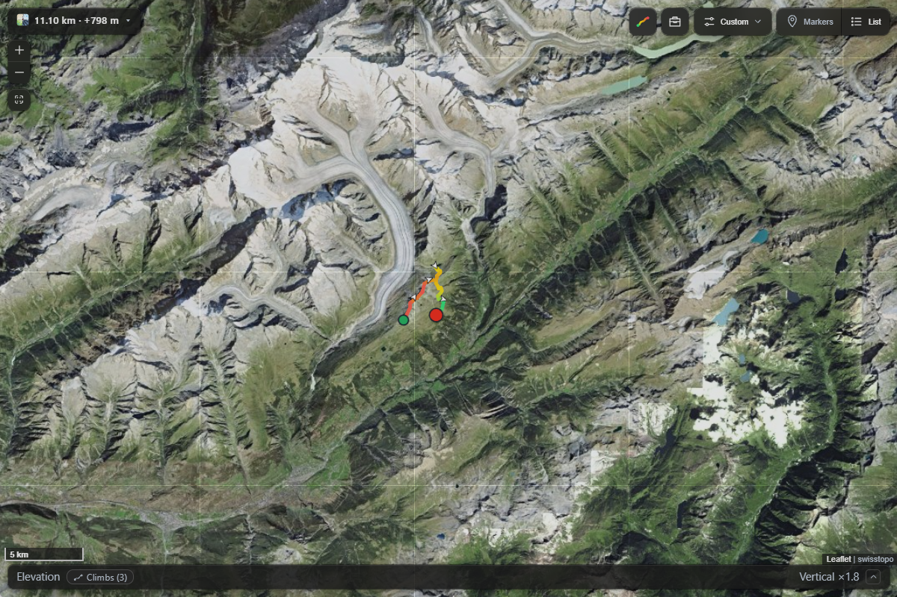

# QuickLook.Plugin.TrailViewer

[简体中文](README.md) | English

Preview GPX, KML, KMZ and FIT tracks directly in QuickLook on Windows. Press <kbd>Space</kbd> on a track file
in Explorer to see the route, waypoints, photos and elevation profile without opening a map application.

| ClimbPro climbs & topo basemap | Per-km splits & heart-rate overlay |
| :---: | :---: |
|  |  |

| Waypoint photos & semantic overview | Minimal view & satellite imagery |
| :---: | :---: |
|  |  |

## Quick start

1. Download the latest `.qlplugin` from [GitHub Releases](https://github.com/luluuuse/QuickLook.Plugin.TrailViewer/releases/latest).
2. Open the package, install it, and restart QuickLook from the tray.
3. Select a `.gpx`, `.kml`, `.kmz` or `.fit` file in Explorer and press <kbd>Space</kbd>.

### Common controls

| Category | Action | Shortcut / Entry |
|---|---|---|
| **View & basemaps** | Switch basemap / Fit complete route | <kbd>Q</kbd> <kbd>E</kbd> / <kbd>C</kbd> |
| | Cycle track coloring | <kbd>L</kbd> |
| | Collapse or expand profile / Hide UI chrome | <kbd>P</kbd> / <kbd>S</kbd> |
| **Waypoints & measure** | Move between waypoints / Show or hide waypoints | <kbd>←</kbd> <kbd>→</kbd> (or <kbd>A</kbd> <kbd>D</kbd>) / <kbd>W</kbd> |
| | Start or finish measuring | <kbd>M</kbd> |
| | Undo / Redo (measure & editor) | <kbd>Ctrl</kbd>+<kbd>Z</kbd> / <kbd>Ctrl</kbd>+<kbd>Shift</kbd>+<kbd>Z</kbd> |
| **Toolbox & editor** | Open or close toolbox | <kbd>T</kbd> |
| | Non-destructive track editor / Save or export | Toolbox → Edit track / <kbd>Ctrl</kbd>+<kbd>S</kbd> |
| | Export overlay image / Route weather | Toolbox → Export overlay / Route weather |

## Highlights

### Maps and basemaps

- **Built-in basemaps & outdoor overlays:** 10 built-in basemaps across Road (OpenStreetMap, Esri Light/Dark Gray, Tianditu), Terrain (CyclOSM, OpenHikingMap, OpenTopoMap, Esri World Topo) and Satellite (Esri Imagery, Tianditu), with multi-node switching, direct host network probing, 3 toggleable transparent outdoor overlays (Waymarked Hiking/Cycling and OpenSnowMap Pistes), and local disk tile caching.
- **Custom sources & offline grid:** 11 one-click custom source presets (Japan GSI, Taiwan RudyMap, US USGS, Swiss swisstopo, Google Satellite, and 4 pro outdoor API-key presets), 512 px tile support, 2bulu placeholder auto-conversion, and an offline Grid (no-map) mode.

### Track analysis and browsing

- **Track coloring & route networks:** Per-segment coloring with adaptive direction arrows and distance labels, plus **Single / Elevation / Speed / Heart rate** coloring; merged multi-route networks are detected automatically and skip global speed, splits and combined-profile calculations for fast loading.
- **Route intelligence & per-km splits:** Moving time, recording gaps, GPS jump detection, and Naismith / Langmuir / steep-uphill time estimates; sortable per-kilometre splits with outlier-resistant proportion bars, synchronized profile spotlighting, and a unified compact left-column stack at `≤ 720 px` width or `≤ 520 px` height.
- **Elevation profile & ClimbPro:** Gradient-colored terrain, quartile distance ticks, horizontal range brush stats (`Esc` to clear), automatic ClimbPro major climb chips, optional heart-rate overlay with whole-route average line, and <kbd>P</kbd> collapse.
- **Waypoints and photo albums:** Route-ordered navigation, portrait 4:3 photo cards, full-screen lightbox (true source-pixel percentages, wheel zoom up to 800%, drag-to-pan, next-photo preloading, and open-in-browser), scrollable plain cards, and local danger/water/camp/exit insight labels.

### Editing and export

- **Non-destructive track editor:** Enter from the Toolbox hero card for **Clip & Merge** (profile crop, click split, segment merge, external GPX/KML append), **Clean & Optimize** (drift cleanup, elevation smoothing, simplify), **Route Direction** (reverse, out-and-back, close loop, loop start), **Draw & Refine** (hand-drawn path, vertex editing, box erase), **Timeline** (timestamp shift, grade-adjusted virtual timeline), and **Waypoint Batch Tools** (sort, dedupe, milestone generation), all backed by multi-step undo/redo.
- **Multi-format export & offline KMZ:** Export to GPX, KML, KMZ (with optional offline remote photo packing and full time/heart-rate preservation), GeoJSON, TCX, or CSV, with same-format overwrite + `.bak` backup for GPX / KML / KMZ.
- **Overlay & attachment export:** Export transparent square, portrait and landscape PNG route overlays (with live preview, ink/backing choices, Track-only mode, and bottom elevation silhouette), plus concurrent resumable export of embedded, Data URI and HTTPS-linked photos.

### Utilities and experience

- **Manual measurement & coordinates:** Multi-section right-click distance measurement with waypoint/point/track snapping and live totals; one-click copy of shareable route summaries and WGS-84 coordinates (with elevation notes) for start, end, peak, map center, or any picked point.
- **Route weather:** Opens Windy in your browser on the cloud layer with hourly forecasts expanded for the selected start, end or peak, without embedding third-party maps.
- **Dual-source updater & bilingual UI:** Quiet 24-hour background checks racing **GitHub Releases + GitCode mirror** with automatic failover (subtle cyan glow dot on the Toolbox toggle and emerald pill in the footer), bilingual release notes, version muting, **SHA256 package verification**, and native QuickLook installer handoff; switch in place between English and Chinese with persistent preferences.

Detailed behaviour, advanced controls and export examples are in [docs/USAGE.md](docs/USAGE.md).

## Compatibility

**Supported preview inputs:**

- **GPX 1.0 / 1.1:** tracks, waypoints, heart-rate extensions, and linked photos
- **KML 2.2:** `LineString`, `gx:Track`, `MultiGeometry`, closed `LinearRing` polygons, and `gx:SimpleArrayData` heart-rate arrays
- **KMZ:** zipped archives with embedded and remote photos, up to `1088 MB` total archive size (`1000 images / 1 GB` media cap, `64 MB` inner `.kml` limit)
- **FIT:** activities and courses with GPS records, compressed timestamps, elevation, heart rate, and course points (brief mode focuses on route data; laps, cadence, power, temperature and workout steps are not shown)

**Supported editor exports:**

- Export edited tracks to **GPX, KML, KMZ, GeoJSON, TCX, or CSV**; GPX, KML and KMZ support same-format overwrite with an automatic `.bak` backup.

**Size & rendering boundaries:**

- Single GPX, KML and FIT files are limited to `64 MB`. Long tracks render continuously with route lines, endpoints and viewport-sampled waypoints—skipping per-sample markers to stay smooth while panning and zooming. Invalid XML produces an explicit error page with the parser message.

## Privacy

The plugin sends no track data to a server. Opening a file reads that file locally. Online basemaps contact
their tile providers when selected, and custom sources contact the addresses you configure. **No-map mode**
renders the route on a local grid. Route weather sends the selected point to Windy. Update checks contact
GitHub / GitCode to fetch release metadata and verify `.qlplugin` SHA256 checksums without uploading any track
data. Preferences are stored in the user's local application data and are not tied to the versioned WebView cache.

## Troubleshooting

- If the preview still looks like the selected file as XML text, confirm the plugin is installed and enabled.
- If an upgrade does not appear, exit QuickLook from the tray completely and start it again.
- If online tiles are blank, check network access or enable **Grid** (No-map mode).
- Esc closes QuickLook previews; use the preview close button when needed.

More diagnostic details are in [docs/DEVELOPMENT.md](docs/DEVELOPMENT.md) and
[docs/TESTING.md](docs/TESTING.md).

## Development

Start with [CONTRIBUTING.md](CONTRIBUTING.md). The main references are:

- [Architecture](docs/ARCHITECTURE.md)
- [Icon system](docs/ICON_SYSTEM.md)
- [Development setup](docs/DEVELOPMENT.md)
- [Testing](docs/TESTING.md)
- [Releasing](docs/RELEASING.md)
- [Changelog](CHANGELOG.md)

Typical local gate:

```text
npm ci
npm run check
dotnet build src/QuickLook.Plugin.TrailViewer.csproj -c Release
npm test
```

Product versions follow Semantic Versioning. WebView cache identity is derived from viewer content and is
independent from the release number.

## Credits and license

This project is a fork of
[McBenac/QuickLook.Plugin.GpxViewer](https://github.com/McBenac/QuickLook.Plugin.GpxViewer), licensed under
the MIT License. The upstream copyright notice is preserved verbatim in [LICENSE](LICENSE), alongside the
copyright for changes made in this fork.
