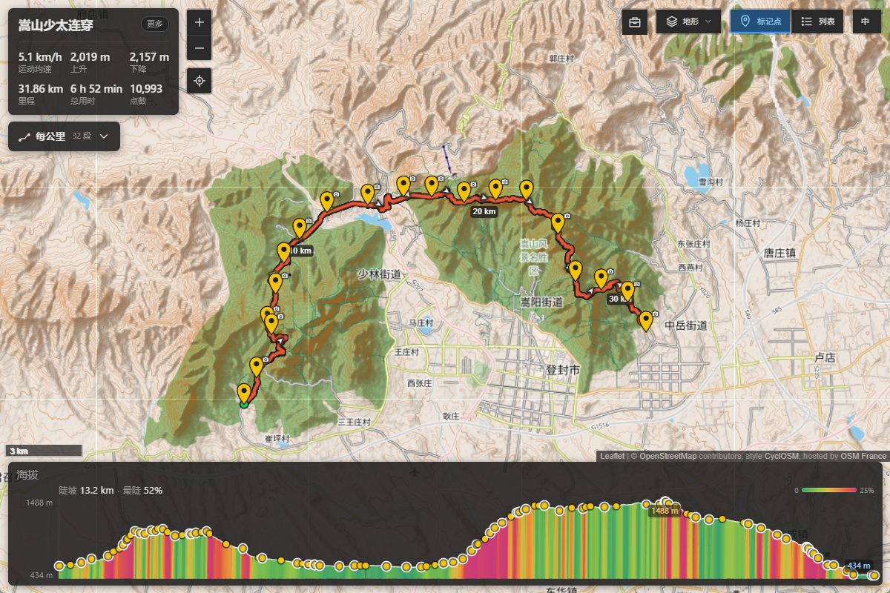

# QuickLook.Plugin.TrailViewer

[简体中文](README.zh-CN.md) | English

Preview GPX, KML, KMZ and FIT tracks directly in QuickLook on Windows. Press <kbd>Space</kbd> on a track file
in Explorer to see the route, waypoints, photos and elevation profile without opening a map application.



## Quick start

1. Download the latest `.qlplugin` from [GitHub Releases](https://github.com/luluuuse/QuickLook.Plugin.TrailViewer/releases/latest).
2. Open the package, install it, and restart QuickLook from the tray.
3. Select a `.gpx`, `.kml`, `.kmz` or `.fit` file in Explorer and press <kbd>Space</kbd>.

Common controls:

| Action | Control |
|---|---|
| Move between waypoints | <kbd>←</kbd> <kbd>→</kbd> or <kbd>A</kbd> <kbd>D</kbd> |
| Fit the complete route | <kbd>C</kbd> |
| Show/hide map markers | <kbd>W</kbd> |
| Change map layer | <kbd>Q</kbd> / <kbd>E</kbd> |
| Hide interface chrome | <kbd>S</kbd> |
| Start/finish measuring | <kbd>M</kbd> |
| Measuring undo / redo | <kbd>Ctrl</kbd>+<kbd>Z</kbd> / <kbd>Ctrl</kbd>+<kbd>Shift</kbd>+<kbd>Z</kbd> |
| Open/close toolbox | <kbd>T</kbd> |
| Export overlay image | Toolbox → Export overlay |
| Open route weather | Toolbox → Route weather |

## Highlights

- **Track rendering:** GPX tracks, KML LineStrings and `gx:Track`, plus FIT activity/course records, each segment in its own colour, with
  adaptive direction arrows and distance labels.
- **Route intelligence:** moving time, recording gaps, implausible GPS jumps and a grade-aware time estimate
  using Naismith, Langmuir descents and a steep-uphill correction.
- **Per-kilometre splits:** an independent entry below the route summary opens on demand to show elapsed time
  and moving speed for every kilometre, with total/moving-time totals. Selecting a row focuses and highlights
  that part of the route on the map. A one-click details mode adds cumulative time, ascent/descent, average
  heart rate, moving speed and vertical speed.
- **Route networks:** merged networks are detected and rendered as independent routes instead of one trip;
  global speed, split and combined-profile calculations are skipped for faster loading and lower memory use.
- **Waypoints and photos:** route-ordered navigation, photo albums with portrait 4:3 cards, true source-pixel
  percentages, wheel zoom up to 800% and drag-to-pan, scrollable plain waypoint cards, and a searchable
  overview with local danger/water/camp/exit insight labels.
- **Elevation profile:** gradient-coloured terrain, waypoint dots, scrub readout and optional per-point heart
  rate overlaid on its own scale with a whole-route average line.
- **Manual measurement:** multi-section point-to-point distance measurement on the map. Right-click adds a
  point while left-drag pans and the wheel zooms; nearby waypoints, previously placed measurement points, and
  recorded track samples snap automatically. Section subtotals and overall distance update live.
- **Copy and attachment export:** copy a shareable summary from the track card, copy WGS-84 coordinates for
  the start, end, peak, map centre or any picked point (with nearby marker snapping and elevation notes), and
  export embedded, Data URI and HTTPS-linked photos beside the source track—either embedded-only or all images
  concurrently with automatic resume.
- **Map sources:** OpenStreetMap HOT (Road), CyclOSM / OpenHikingMap / OpenTopoMap (Terrain), Tianditu road
  and satellite imagery with a user-owned key, an offline Grid (no-map) mode, and persistent HTTPS Custom
  sources (including two-step placeholders and 512 px tiles).
- **Overlay export:** export transparent square, portrait and landscape PNG route overlays with a live preview,
  selectable ink and backing, route name, date and trip statistics (or route-network length and segment counts).
- **Route weather:** opens Windy in your browser on the cloud layer with hourly forecasts expanded for the
  route's start, end or peak (when reliable elevation is available), without embedding third-party maps.
- **Bilingual interface:** switch in place between English and Chinese without reloading the preview, with
  persistent map, marker and export preferences.

Detailed behaviour, advanced controls and export examples are in [docs/USAGE.md](docs/USAGE.md).

## Compatibility

Supported inputs:

- GPX 1.0 and 1.1
- KML 2.2, including `gx:Track` and `MultiGeometry`
- Zipped `.kmz` archives
- FIT activities and courses with GPS records, compressed timestamps, elevation and course points

FIT previews focus on route data. Recorded heart rate can be overlaid on the profile. Laps, cadence, power,
temperature and workout steps are not shown in the first version.

Files with more than 20,000 recorded points still draw the route and endpoints but stop creating a clickable
marker for every sample. Invalid XML produces an explicit error page with the parser message.
Each input file is limited to 64 MB.

## Privacy

The plugin sends no track data to a server. Opening a file reads that file locally. Online basemaps contact
their tile providers when selected, and custom sources contact the addresses you configure. **No-map mode**
renders the route on a local grid. Route weather sends the selected point to Windy. Preferences are stored in
the user's local application data and are not tied to the versioned WebView cache.

## Troubleshooting

- If the preview still looks like the selected file as XML text, confirm the plugin is installed and enabled.
- If an upgrade does not appear, exit QuickLook from the tray completely and start it again.
- If online tiles are blank, check network access or enable **Grid** (No-map mode).
- Esc closes QuickLook previews; use the preview close button when needed.

More diagnostic details are in [docs/DEVELOPMENT.md](docs/DEVELOPMENT.md) and
[docs/TESTING.md](docs/TESTING.md).

## Development

Start with [CONTRIBUTING.md](CONTRIBUTING.md). The main references are:

- [Architecture](docs/ARCHITECTURE.md)
- [Icon system](docs/ICON_SYSTEM.md)
- [Development setup](docs/DEVELOPMENT.md)
- [Testing](docs/TESTING.md)
- [Releasing](docs/RELEASING.md)
- [Changelog](CHANGELOG.md)

Typical local gate:

```text
npm ci
npm run check
dotnet build src/QuickLook.Plugin.TrailViewer.csproj -c Release
npm test
```

Product versions follow Semantic Versioning. WebView cache identity is derived from viewer content and is
independent from the release number.

## Credits and license

This project is a fork of
[McBenac/QuickLook.Plugin.GpxViewer](https://github.com/McBenac/QuickLook.Plugin.GpxViewer), licensed under
the MIT License. The upstream copyright notice is preserved verbatim in [LICENSE](LICENSE), alongside the
copyright for changes made in this fork.
