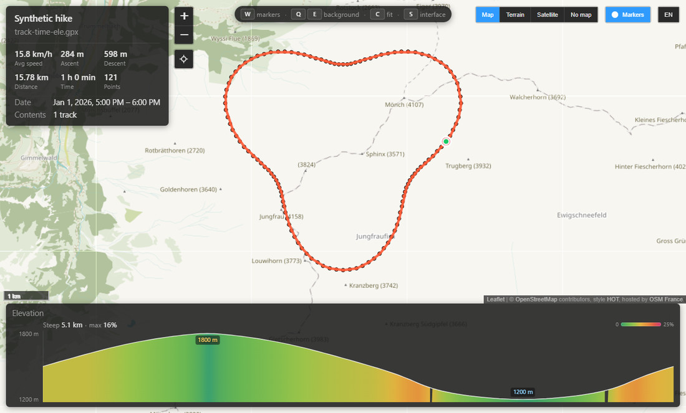
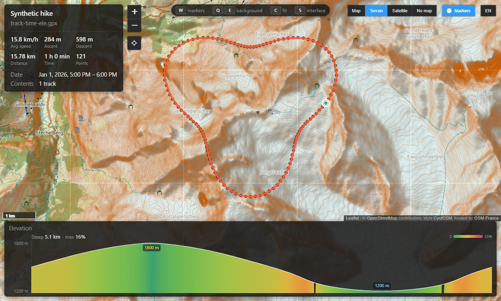
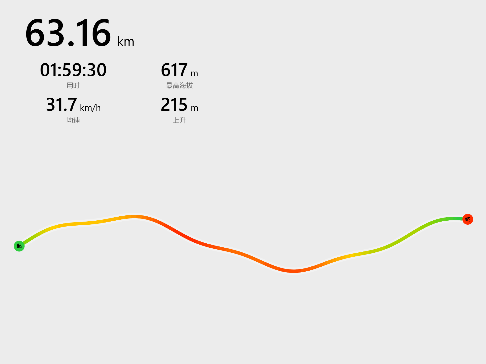

# QuickLook.Plugin.TrailViewer

[English](README.md) | [简体中文](README.zh-CN.md)

Preview GPX and KML tracks on Windows without opening a map app: select a `.gpx`, `.kml` or `.kmz` file in
Explorer, press <kbd>Space</kbd>, and see where the track goes.



This is a plugin for [QuickLook](https://github.com/QL-Win/QuickLook), the free app that brings macOS-style
Quick Look to Windows: pressing <kbd>Space</kbd> on a file in Explorer shows a preview of it. Without the
plugin, QuickLook shows a `.gpx` file as XML text and a `.kmz` as a zip. With it, the track is drawn on a
map, with its date, distance and duration.

## Credit

This plugin is a fork of **[McBenac/QuickLook.Plugin.GpxViewer](https://github.com/McBenac/QuickLook.Plugin.GpxViewer)**
(MIT, © 2026 McBenac). GPX parsing, the map view, the preview window and the original interface are his
work. Everything from 1.1.0 on — KML/KMZ, waypoint photos, the interactive elevation profile, keyboard
navigation and the English/Chinese interface (see [CHANGELOG.md](CHANGELOG.md)) — was added in this fork.
The upstream copyright notice is kept verbatim in [LICENSE](LICENSE), next to the copyright of this fork
(© 2026 luluuuse), and both ship inside the `.qlplugin`.

这个插件基于 **McBenac** 的开源项目
[QuickLook.Plugin.GpxViewer](https://github.com/McBenac/QuickLook.Plugin.GpxViewer)（MIT，© 2026 McBenac）
二次开发。GPX 解析、地图视图、预览窗口和原始界面都来自他的作品；1.1.0 起的 KML / KMZ、标记点照片、
可交互海拔剖面、键盘浏览和中英文界面（见 [CHANGELOG.md](CHANGELOG.md)）是在此基础上加的。
上游版权声明原样保留在 [LICENSE](LICENSE) 中，并随 `.qlplugin` 一起分发。

## What it shows

- Tracks (`trk` in GPX; `LineString` and `gx:Track` in KML, including inside `MultiGeometry`) as lines, each
  segment in its own colour, with the start (green) and end (red) marked and a dot for every recorded point
  (up to 20,000 points, see [Large files](#large-files)). Click a dot for its time, coordinates and
  elevation. Direction arrows and distance labels adapt to the route's projected screen length: long overviews
  use coarser 5/10/20 km milestones and zooming in returns to 1 km detail; a shorter route still gets a midpoint
  arrow.
- Routes (`rte`) as dashed lines and waypoints (`wpt`) as pins; in KML a `Point` placemark is a pin and a
  `Polygon` is drawn as a faint blue area beneath the track, with its name on hover.
- Waypoint photos: a placemark whose description carries an `` gets a camera badge, and its pin opens
  a small card of thumbnails first — the full-size picture is one click further, so a photo never fills the
  screen unasked.
- Waypoint overview: the **List** button orders every waypoint by track distance and shows its name, cumulative
  distance, elevation, photo count and description snippet. Click a row to select and locate its pin while the
  list stays open for scanning camps, junctions, water sources and photo stops. Phase-one local insights tint
  danger, water, camp, junction and summit/pass rows in different colours, with text badges, multi-label support,
  Chinese/English negation handling, evidence and filters. Phase two reads complete descriptions sentence by
  sentence, uses KML/GPX icon hints, adds rescue/bailout/supply/crossing/access/viewpoint categories and merges
  points within 25 m in the overview. A single Filter menu in the header replaces both horizontal strips, while
  a pencil button opens each row's correction menu only when needed; corrections remain local and persistent.
  Colour is never the only cue.
- Long routes use 24×27 px yellow waypoint pins thinned by screen distance. Ordinary pins closer than about
  34 px are not drawn together at the current zoom and appear progressively as the map is enlarged. Important
  semantic points and the current keyboard selection always remain visible. Raw stops, photos and the overview
  list are unchanged. W also hides gap icons and GPS anomaly labels together with the pins, while dashed gap
  connectors and cyan anomaly line overlays remain in the track layer.
- A summary box: name, date, point count, distance, moving average speed, total time, ascent, descent, recording
  breaks and file contents. Hovering **Total time** shows both moving time and the grade-aware estimate. KML
  `TimeUsed` / `PauseTime` metadata is used directly for moving time; other files fall back to movement
  estimation. The estimate uses a Naismith base, Langmuir gentle/steep descents, and a 10-minute / 300 m
  penalty for ascents steeper than 12 degrees. The climb is measured after a short moving average and only
  counts reversals of ten metres or more; its tooltip also reports the raw total. Compact is the default card
  mode and shows only the title plus six basic figures. More/Less reveals date, track anomalies, contents and
  photos; the choice persists. The redundant file-name line is removed, with the route name and full file name in
  the title tooltip. GPS and data-gap icons expose counts and distance on hover; click or press Enter to zoom
  to the event. The route opens inside the measured map area that is not covered by the summary, toolbars or
  profile, and pin navigation recentres only when the selected card approaches an edge.
- Data gaps between recorded track parts use red warnings and, where large enough, a dashed connector. Implausible
  speed or position jumps inside one part use a cyan-on-white dashed overlay with a `GPS ×N` badge, so a
  continuous-looking line is not misreported as broken. A single bad point is counted once, nearby episodes
  cluster at the current zoom, and the summary keeps data-gap distance separate from affected sample distance.
  At low zoom nearby anomalies consolidate into GPS bands with only a few plain `GPS` labels; data gaps and speed
  anomalies share one Track anomalies row as two lines. The summary card is capped at 310 px.
- An elevation profile across the bottom when the track has elevation (`<ele>`): a translucent panel floating
  over the map, which runs to the bottom edge of the window behind it. The area under the curve is coloured
  by the gradient itself -- green at level ground, yellow around 10 %, orange-red past 20 %, capped at 25 % --
  so the climb is visible before the axis is read. Above it sits how much of the route is steep and the worst
  gradient on it, with the colour bar those numbers were read from, and the highest and lowest points are
  labelled on the curve where the route reached them. Waypoints sit on the profile where the track passes
  them, and clicking one opens the same pin
  the map would. Running the mouse along the profile shows the altitude at the cursor, with the distance and
  time it was reached, in a small see-through card just above the pointer: transparent enough that the bands
  and the curve stay visible underneath, which is the whole point of reading a position off it.
  The panel is as tall as the drawing needs, and the drawing is as tall as the route needs: its height is
  worked out so that a metre of climb takes about three times the pixels of a metre of ground. Without that
  the height was fixed and the width was not, so the same climb read 1.7x in a wide window and 3.1x in a
  narrow one. Routes that fall outside the band -- a few metres of height over 40 km, or 500 m over two --
  are held at a floor and a ceiling, and the caption beside the title states the exaggeration it settled on.
- Four backgrounds, switched at the top right: **Map** (OpenStreetMap, Humanitarian style),
  **Terrain** (CyclOSM: contours, hill shading, spot heights and trails), **Satellite** (Esri World
  Imagery) and **No map** (the track on a plain grid). The choice is remembered.

  
- One button next to the backgrounds hides the dots on the map: the waypoint pins and the dot on every
  recorded point. That is what makes the shape of a long route readable -- a 4,700-point track is
  otherwise a band of dots. The same waypoints are drawn a second time on the profile, and this switch
  takes both lots at once, so the profile never points at markers the map has stopped showing. Lines,
  areas, the start/end flags, the curve and the axis stay; the choice is remembered, and a file that
  draws no dots at all gets no button.
- A button under the zoom buttons -- and <kbd>C</kbd> -- puts the whole track back in view, framed
  exactly as the file opened. It is the way home after panning away or following a pin to one stretch.
- <kbd>X</kbd> saves the track as a transparent PNG to lay over a photo, with the totals beside it and the
  route coloured by height. The button sits under the locate one; see
  [Exporting the track as a picture](#exporting-the-track-as-a-picture) for the three shapes.
- An English or Chinese interface, following the system language on first use and switched by one button
  next to the backgrounds. The choice is remembered, and switching repaints what is already on screen -
  the summary, an open card, the profile and the photo bar - without reloading the page.
- A measured three-state layout for narrow windows: `inline` keeps everything in the top band, `wrapped` lets
  the right-hand tools use a second row while zoom stays beside the summary, and `docked` gives both groups
  their own band below it. A full summary scrolls internally when height is scarce, and very narrow windows
  collapse the marker and list switches to labelled icons.

GPX 1.0 and 1.1, KML 2.2 (including `gx:Track` and `MultiGeometry`) and zipped `.kmz` archives are supported;
only the KML document inside a `.kmz` is unpacked, into a temporary folder that lives exactly as long as the
preview. A file that is not valid XML shows an error page with the parser's message.

Interface text lives in `viewer/i18n.js`: one table per language, values either a string with `{placeholders}`
or a function for the cases a string cannot express (Chinese does not pluralise). Adding a language means
adding a table and the two-letter code to `LANGS`.

[CHANGELOG.md](CHANGELOG.md) starts with one entry that describes the whole plugin as 1.16.6 shipped it, and
each release since is a new entry on top of it saying what that version changed. Entries are added, never
rewritten, so the log reads as a history rather than a description that quietly changes.

## Keyboard

<kbd>←</kbd> <kbd>→</kbd> or <kbd>A</kbd> <kbd>D</kbd> step through the waypoints: the selected pin is
ringed in blue, the map keeps it in view and its card opens, so the placemark's text and photos can be read
one after another without touching the mouse. While a full-size photo is open the same keys walk the photos
and continue into the neighbouring pin at the end of an album. If the pins were hidden with the switch, a key
press brings them back first. Navigation follows cumulative route distance rather than the file's placemark
order. A green start or red end sharing a position with a yellow pin is one navigation node, not two.

The directional keys and A/D still step through waypoints. The **List** button complements them by showing the
whole route in the same distance order; clicking a row selects and locates its pin while leaving the list open
for comparison with the next place.

QuickLook keeps <kbd>Space</kbd> and <kbd>Esc</kbd> for itself, so the viewer does not close on <kbd>Esc</kbd>:
click the × or outside the picture. If arrow keys happen to be taken by something else on your machine,
<kbd>A</kbd> and <kbd>D</kbd> do the same thing.

<kbd>W</kbd> flips the markers on and off -- the pins and dots on the map and the waypoint dots on the
profile, since they are the same waypoints drawn twice. It is the same thing the button does. <kbd>Q</kbd> and <kbd>E</kbd>
step the background backwards and forwards through Map, Terrain, Satellite and No map, wrapping at either
end, and the choice is remembered like a click. Both keys are ignored while a full-size photo is open —
a background change behind the photo would only be noticed after closing it — and a held key counts once,
so the markers do not blink.

<kbd>C</kbd> puts the whole track back in view: the same frame the file opened with, so a walk that spans
two valleys comes back as it was rather than at whatever zoom the last gesture stopped on. It is the same
thing the locate button does, and it is ignored while a full-size photo is open, like the other keys.

<kbd>S</kbd> clears the map: the summary, the elevation profile and every button go, leaving
the map itself -- track, markers, scale and credit line -- the view to hand someone who only wants to see the
shape of the walk. A hint fades in the middle of the screen the first time, because otherwise there would be
nothing on screen saying how to get the interface back; <kbd>S</kbd> again puts it back. Like the other keys
it stands aside while a full-size photo is open, where there would be nothing left to see.

<kbd>X</kbd> exports the overlay with the last settings, and <kbd>⇧X</kbd> opens the panel that sets them.
Both stand aside while a full-size photo is open, like the other keys.

The keys answer on the first press: QuickLook shows its preview without activating it, so the plugin catches
W, Q, E, C, S, X and ⇧X with a low-level keyboard hook of its own, exactly the way QuickLook catches Space and
the arrows. The hook only exists while a preview is on screen and only takes the keys when the foreground is
this preview or the file manager it was opened from; anywhere else they are ordinary letters. What the keys
are is written where they are used: the tooltip of each button names its key.

## Exporting the track as a picture

<kbd>X</kbd> writes a transparent PNG next to the file being previewed: the route coloured by height from green
to red, a badge at each end, and distance, time, highest point, average speed and ascent set beside it. It is
drawn from the parsed points rather than captured from the screen, so it ignores the current zoom, pan,
background and window size -- and the background really is transparent, ready to be laid over a photo. Its
labels are written in the interface language, which is why the picture below reads Chinese: it came from a
Chinese install.



<kbd>⇧X</kbd> opens the panel that sets it. All three choices are remembered, and <kbd>X</kbd> then exports
with them.

| Setting | | |
| --- | --- | --- |
| **Shape** | **Portrait** | 1080 × 1920, the phone screen. The default. |
| | **Square** | 1536 × 1536, for a post that is not a story. |
| | **Wide** | 2048 × 1536, read top down: the figures in the top left corner, the track across the band below. |
| **Ink** | **Black** / **White** | Black is the default and needs nothing behind it on a bright photo. |
| **Backing** | **None** / **Soft** | A soft wash for a photo the type would otherwise sink into. It follows the ink: light behind black, dark behind white. |

The shapes are named for the job rather than for their proportion, because "1:1" does not say which one belongs
on a photo. Sizes are chosen for being laid into *part* of one, not over all of it: a 12 MP frame's short edge
is about 3000 px, and half of that is what the picture occupies when it sits in one half of the frame.

The portrait and square pages stack the figures in a right-hand column, right-aligned against a rule. The wide
page is a different layout rather than a rotation: the distance becomes the heading -- largest type, top left,
flush with the column edge, with no name under it -- and the other four sit beneath in a 2 × 2 block, number
over label, centred in their cell, the label in a lighter ink. Its track band is about 2 : 1, so a track that
runs east-west uses the whole width; a loop or a north-south track fills the height and centres instead.

The file is named after the source with the proportion appended -- `2026-05-02-traverse-track-4x3.png` -- so two
shapes of one track never overwrite each other while a re-export of the same shape updates in place. A file
without height data falls back to a single colour and drops the two height rows.

## Large files

- **More than 20,000 track points** in a file: the tracks are drawn as lines with the start and end marked,
  but without a clickable dot for every point. Far more dots than that slow the preview down, and around
  200,000 crash it.
- **Tested up to 30,000 points**, which load in about a second on the current test machine. The elevation
  drawing is reduced to the pixels the 600-unit plot can show while keeping each column's low and high sample,
  and export simplifies the projected path below sub-pixel detail. Larger files have not been tested and may
  take longer than the preview's 20-second limit. The preview then shows *Timed out while loading the
  preview.* Open such files in a map app instead.

## Privacy

In **Map**, **Terrain** and **Satellite** mode the map tiles are downloaded from
[OpenStreetMap France](https://www.openstreetmap.fr/) (`*.tile.openstreetmap.fr`, plus the CyclOSM
terrain tiles at `tile-cyclosm.openstreetmap.fr`) and [Esri](https://www.esri.com/)
(`server.arcgisonline.com`). Which tiles are requested reveals roughly where the track is, and the servers
see your IP address. Nothing else leaves your computer: the file is read locally and is never uploaded.

**No map** downloads nothing. Choose it once and it stays the default for the next previews.

## Install

**Prerequisites:** [QuickLook 4.x](https://github.com/QL-Win/QuickLook/releases/latest) — install it first; the plugin
is installed through QuickLook itself. It also needs the Microsoft Edge WebView2 Runtime, which Windows 10 and 11
already have.

1. Download `QuickLook.Plugin.TrailViewer-<version>.qlplugin` from [Releases](../../releases).
2. Select it in Explorer, press <kbd>Space</kbd> and click **Click here to install this plugin.**
3. Click **Restart now...** when the installation is done.

## Controls

- Drag to move the map, mouse wheel to zoom. A notch moves a whole level; hold <kbd>Alt</kbd> and the same
  notch moves half of one, for putting a switchback under the pointer instead of somewhere in a view that just
  doubled. The <kbd>+</kbd> and <kbd>-</kbd> buttons keep moving a whole level either way. The elevation
  profile only takes the mouse over the chart itself, so a drag that starts on its empty area still moves the
  map underneath.
- <kbd>Space</kbd> or <kbd>Esc</kbd> closes the preview, and the arrow keys move to the next file, as usual in
  QuickLook.

## Troubleshooting

Each preview adds one line to `%LOCALAPPDATA%\GpxViewer\log.txt` with the file, the number of points and
the distance, how long it took, or the error. Remembered interface choices live in
`%LOCALAPPDATA%\GpxViewer\viewer-settings.txt`, outside the versioned WebView2 origin.

## Building

The plugin is a .NET Framework 4.6.2 class library (WPF, WebView2) and builds on Windows. From a clone of
this repository:

```
npm ci
npm run check
pwsh scripts/get-quicklook-common.ps1
dotnet build src/QuickLook.Plugin.TrailViewer.csproj -c Release
npm test
node scripts/pack.cjs
```

`get-quicklook-common.ps1` fetches `QuickLook.Common` from the QuickLook release named in `quicklook-version.txt`,
so the plugin is built against the same library QuickLook ships. The version lives in one place only -- the
`Directory.Build.props`. `QuickLook.Plugin.Metadata.config` is a template whose `@VERSION@` the build fills
in, because QuickLook reads a plugin's version from that file rather than from the assembly. Product versions
follow Semantic Versioning; the WebView2 virtual host is instead derived from a hash of the shipped viewer
files and the page protocol. A frontend fix therefore refreshes its own cache without manufacturing a release
version. GitHub Actions does the same on every pull request, checks the file detection against the test files,
runs every browser suite and uploads the `.qlplugin`.

`npm run check` runs ESLint over the viewer, tests, scripts and tools, then TypeScript's `checkJs` over the
browser modules. The same command gates CI before the Windows build.

The regular `npm test` first runs 53 Node-only unit tests, then 22 browser suites, the failure-bundle self-test
and the version checks. The static server, browser launcher, assertions and diagnostics live in
`tests/support/`; failures write a screenshot, result JSON and Playwright `trace.zip` under
`test-results/<suite>/`. After building the Harness, `npm run test:host` adds 50 C# assertions for host-side
file boundaries, preferences, the overlay transfer state machine and atomic publication. The main test path
never contacts a live map service. CyclOSM availability is checked separately by the weekly/manual
`live-smoke` workflow.

The web viewer in `viewer/` can be opened in any browser through a local web server, for example
`viewer/index.html?src=../tests/fixtures/track-time-ele.gpx`. The scripts under `tests/` drive it in Chromium
with [Playwright](https://playwright.dev/), one file per area: `viewer-test.cjs` holds the numbers against
`tests/fixtures/expected.json`, and the rest cover photos, waypoint navigation and overview, direction/kilometre
markers, moving time and recording gaps, the pin switch, the terrain layer, the keyboard shortcuts, the two
languages, the profile and its cursor readout, the profile's height and vertical scale, the locating button, the
overlay export, the portrait layout, measured map focus and the version numbers. All
of them are plain Node scripts and print one `PASS` or `FAIL` line per check. After `npm ci`, set Edge as the
browser and run the same aggregate command CI uses:

```
set CHROMIUM=<path to chrome or msedge.exe>
npm test
```

Formal releases are prepared with `node scripts/release.cjs patch`, `minor`, or `major`; add
`--pre beta.1` / `--pre rc.1` for a prerelease. The script edits only the authoritative version source and
CHANGELOG. Push an annotated tag such as `v1.17.0`; the release workflow verifies tag/version equality, runs the
full suite, packs the plugin and publishes the package with SHA256. `npm run test:version` needs no browser and
verifies SemVer, changelog order, build metadata, protocol/preference versions and the content-derived cache
host. Test files are synthetic and generated by `tools/make-fixtures.py`.

## Third-party components

`viewer/vendor/leaflet/` contains an unmodified copy of [Leaflet](https://leafletjs.com/) 1.9.4
(BSD 2-Clause licence, alongside). The version is recorded in `viewer/vendor/versions.json`.
Map data © [OpenStreetMap](https://www.openstreetmap.org/copyright) contributors; satellite imagery © Esri
and its data providers.

## License

MIT
