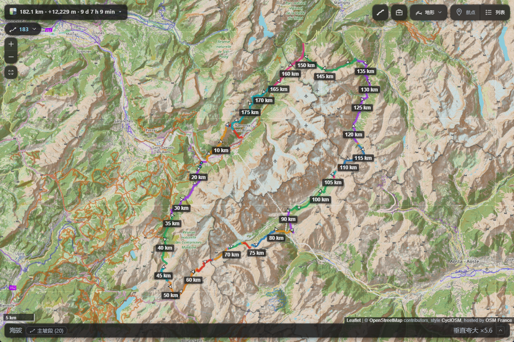
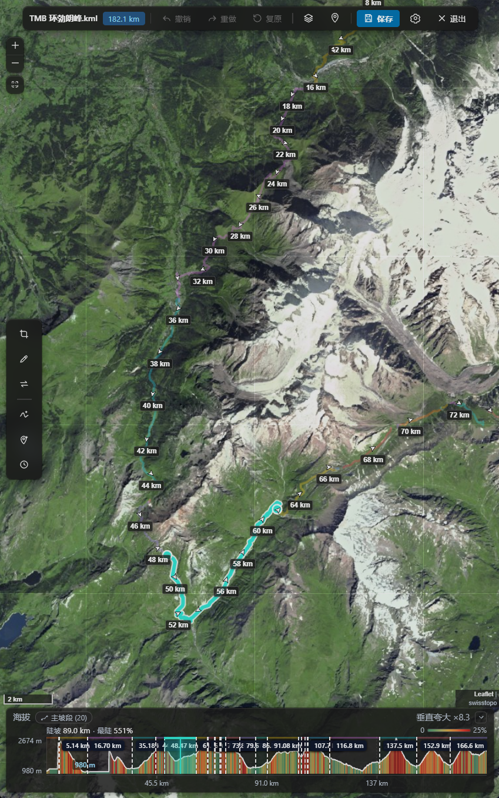
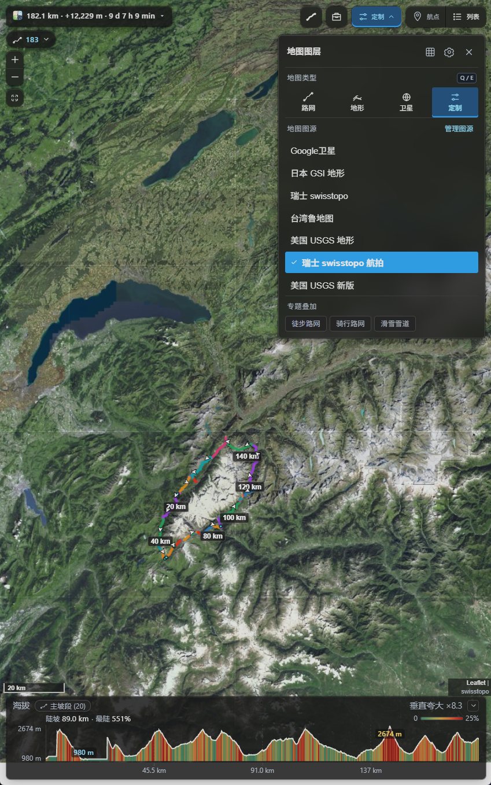
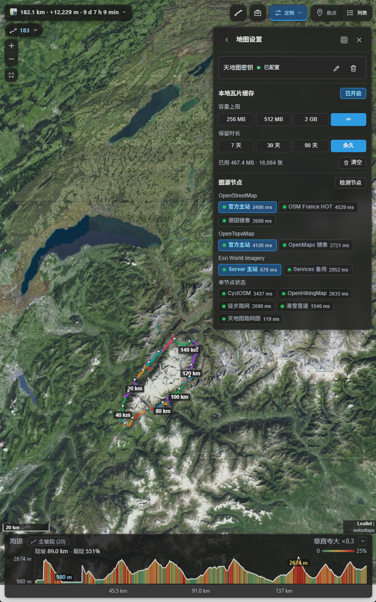
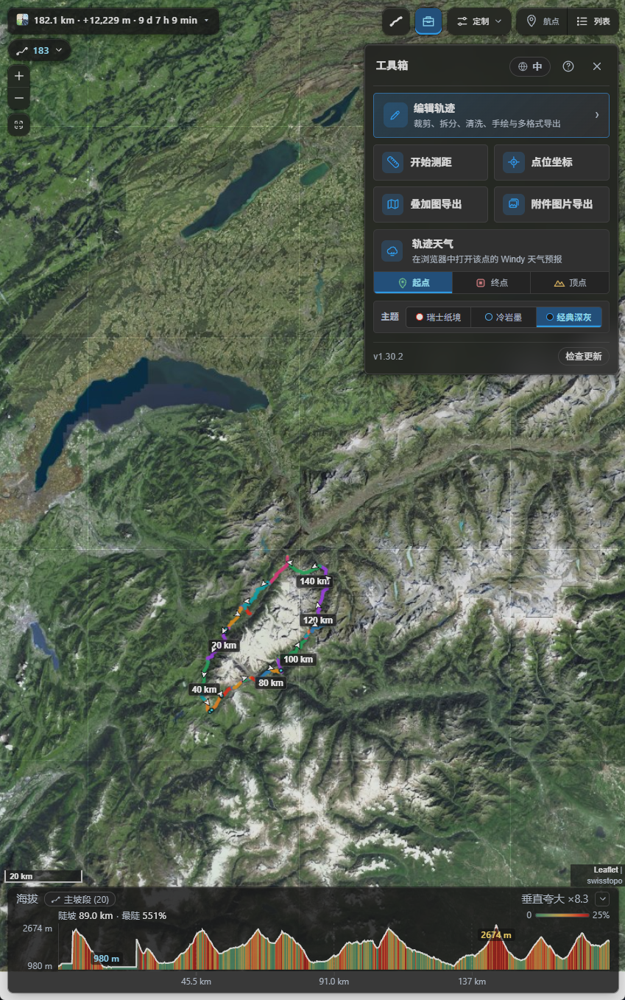

# QuickLook.Plugin.TrailViewer

简体中文 | [English](README.en.md)

在 Windows 上直接用 QuickLook 预览 GPX、KML、KMZ 和 FIT 轨迹。在资源管理器中选中轨迹文件并按
<kbd>Space</kbd>，无需打开地图软件即可查看路线、航点、照片和海拔剖面。

<table>
  <tr>
    <th width="50%" align="center">ClimbPro 主坡段与地形底图</th>
    <th width="50%" align="center">♥️</th>
  </tr>
  <tr>
    <td width="50%" align="center"></td>
    <td width="50%" align="center"></td>
  </tr>
  <tr>
    <th width="50%" align="center">航点照片卡片与语义速览</th>
    <th width="50%" align="center">极简视野与卫星航拍</th>
  </tr>
  <tr>
    <td width="50%" align="center"></td>
    <td width="50%" align="center"></td>
  </tr>
  <tr>
    <th width="50%" align="center">无损轨迹编辑器</th>
    <th width="50%" align="center">地图图层与透明叠加</th>
  </tr>
  <tr>
    <td width="50%" align="center"></td>
    <td width="50%" align="center"></td>
  </tr>
  <tr>
    <th width="50%" align="center">地图设置与节点测速</th>
    <th width="50%" align="center">统一工具箱</th>
  </tr>
  <tr>
    <td width="50%" align="center"></td>
    <td width="50%" align="center"></td>
  </tr>
</table>

## 快速开始

1. 从 [GitHub Releases](https://github.com/luluuuse/QuickLook.Plugin.TrailViewer/releases/latest) 下载最新
   `.qlplugin`。
2. 打开安装包完成安装，并从托盘完全退出后重新启动 QuickLook。
3. 在资源管理器中选中 `.gpx`、`.kml`、`.kmz` 或 `.fit` 文件，按 <kbd>Space</kbd>。

### 常用操作

| 场景 | 操作 | 快捷键 / 入口 |
|---|---|---|
| **视图与底图** | 切换底图 / 回到完整轨迹 | <kbd>Q</kbd> <kbd>E</kbd> / <kbd>C</kbd> |
| | 切换轨迹热力着彩 | <kbd>L</kbd> |
| | 收起或展开海拔剖面 / 隐藏界面 | <kbd>P</kbd> / <kbd>S</kbd> |
| **航点与测距** | 切换航点 / 显示或隐藏航点 | <kbd>←</kbd> <kbd>→</kbd>（或 <kbd>A</kbd> <kbd>D</kbd>） / <kbd>W</kbd> |
| | 开始或结束测距 | <kbd>M</kbd> |
| | 撤销 / 重做（测距与编辑通用） | <kbd>Ctrl</kbd>+<kbd>Z</kbd> / <kbd>Ctrl</kbd>+<kbd>Shift</kbd>+<kbd>Z</kbd> |
| **工具箱与编辑** | 打开或关闭工具箱 | <kbd>T</kbd> |
| | 无损轨迹编辑 / 保存导出 | 工具箱 → 编辑轨迹 / <kbd>Ctrl</kbd>+<kbd>S</kbd> |
| | 叠加图导出 / 轨迹天气 | 工具箱 → 叠加图导出 / 轨迹天气 |

## 功能概览

### 地图与底图

- **多图源与户外叠加层**：内置 10 套底图，覆盖路网（OpenStreetMap、Esri 浅灰/深灰、天地图）、地形（CyclOSM、OpenHikingMap、OpenTopoMap、Esri 地形）与卫星（Esri 影像、天地图），支持多节点切换、宿主直连真实网络测速、3 套透明户外叠加层（徒步/骑行/雪道）及本地瓦片磁盘缓存。
- **定制图源与无底图模式**：内置 11 套定制图源一键预设（含日本 GSI、台湾鲁地图、美国 USGS、瑞士 swisstopo、Google 卫星及 4 套专业户外 API Key 预设），支持两步路占位符、512 px 地址与离线网格无底图模式。

### 轨迹分析与浏览

- **多维着彩与路网识别**：按段着色并自适应显示方向箭头与公里标签，支持 **单色 / 海拔 / 配速 / 心率** 热力着彩；自动识别多路线合并的路网文件，跳过全局速度、分段表和合并剖面以提升性能。
- **路线分析与每公里分段**：计算运动时间、数据缺口、GPS 异常跳点与基于 Naismith / Langmuir / 陡上坡修正的用时估算；每公里分段表支持点击排序、抗极值比例条（自动标识坐车/长休异常段）、剖面联动聚焦及窄窗（`≤ 720 px` 宽或 `≤ 520 px` 高）同步精简。
- **海拔剖面与 ClimbPro**：坡度着色、四等份里程刻度、区间拖拽刷选统计（`Esc` 清除）、ClimbPro 主坡段自动识别、逐点心率与平均心率虚线叠加，支持 <kbd>P</kbd> 键一键折叠。
- **航点与照片相册**：按路线顺序切换图钉，支持竖幅 4:3 照片卡片、全览灯箱（真实像素比例、最高 800% 滚轮缩放、拖拽平移、下一张后台预载及在浏览器中打开原图）、可滚动普通航点卡片与本地危险/水源/营地/下撤语义提示。

### 编辑与导出

- **无损轨迹编辑**：工具箱顶部一键进入轨迹编辑器，覆盖 **剪辑拼接**（剖面裁剪、点击拆分、分段合并、外部 GPX/KML 拼接）、**清洗优化**（漂移点清洗、海拔平滑、抽稀）、**路线方向**（反转、往返、闭合环线、改起点）、**绘制修点**（手绘补线、顶点微调、框选擦除）、**时间轴**（时间平移、坡度估算虚拟时间轴）与 **航点批量工具**（沿轨重排、去重、自动里程点），全程支持撤销与重做。
- **多格式保存与离线打包**：支持导出 GPX / KML / KMZ（可选离线打包外链照片，完整保留时间与心率）/ GeoJSON / TCX / CSV，GPX / KML / KMZ 均支持同格式覆盖并自动留存 `.bak` 备份。
- **叠加图与附件导出**：支持导出方版、竖版和横版透明 PNG 轨迹叠加图（提供实时预览、墨色与底衬、仅轨迹极简模式及底部海拔轮廓剪影）；支持将内置图片、Data URI 和 HTTPS 外链图片导出到轨迹旁（三路并发与断点续传）。

### 实用工具与体验

- **手动测距与点位坐标**：多段右键打点测距，自动吸附航点、已有测距点或轨迹点并实时显示段距与总距；一键复制分享摘要及起点、终点、顶点、地图中心或任意拾取点的 WGS-84 坐标（附海拔备注）。
- **轨迹天气**：在浏览器中打开 Windy（默认云层）并直接展开所选起点、终点或顶点的逐小时天气预报，预览页不内嵌第三方地图。
- **双源自动更新与双语界面**：工具箱底部内置检查更新，每 24 小时静默竞速检测 **GitHub Releases + GitCode 国内镜像**（有新版时顶部显示青蓝微光提示点、底部显示翠绿胶囊），支持双语更新日志、忽略版本、安装包 **SHA256 强校验** 与一键调起 QuickLook 原生安装；界面支持中英文就地切换并持久保存偏好。

完整操作、快捷键和导出说明见 [docs/USAGE.md](docs/USAGE.md)。

## 兼容范围

**预览输入格式：**

- **GPX 1.0 / 1.1**：轨迹、航点、心率扩展与外链照片
- **KML 2.2**：`LineString`、`gx:Track`、`MultiGeometry`、`LinearRing` 闭合多边形及 `gx:SimpleArrayData` 逐点心率
- **KMZ**：压缩包内嵌与外链照片，单包总上限 `1088 MB`（内嵌图片上限 `1000 张 / 1 GB`，内含 `.kml` 文档上限 `64 MB`）
- **FIT**：带 GPS 记录、压缩时间戳、海拔、心率和路线点的活动/路线（简要模式聚焦路线基础数据，步频、功率、温度、训练步骤和完整设备指标暂不展示）

**编辑导出格式：**

- 支持导出 **GPX / KML / KMZ / GeoJSON / TCX / CSV** 六种格式；其中 GPX / KML / KMZ 支持同格式覆盖并自动留存 `.bak` 备份。

**体积与渲染边界：**

- GPX、KML 和 FIT 单个输入文件上限为 `64 MB`。长轨迹会完整绘制路线线条、起终点及按视口抽样的航点，不再为每个原始采样点单独生成圆点标记，以保持拖动与缩放流畅。非法 XML 会显示包含解析器原始错误信息的页面。

## 隐私

插件不会把轨迹数据发送到服务器。打开文件时只在本地读取。选择在线或定制底图时会向对应瓦片服务请求地图；**无底图模式**由本地网格绘制。使用轨迹天气会把所选点坐标随链接发送给 Windy。检查更新会访问 GitHub / GitCode 获取版本信息与安装包并校验 SHA256（不上传任何用户轨迹或文件信息）。偏好保存在本机应用数据中，与带版本号的 WebView 缓存无绑定关系。

## 疑难处理

- 如果预览仍显示 XML 文本，请确认插件已安装并启用。
- 升级后界面没有变化时，请从托盘完全退出并重新启动 QuickLook。
- 在线瓦片空白时检查网络，或点击图层标题栏中的网格图标开启 **无底图模式**。
- <kbd>Esc</kbd> 归 QuickLook 管理；需要时使用预览关闭按钮。

更多诊断信息见 [docs/DEVELOPMENT.md](docs/DEVELOPMENT.md) 和 [docs/TESTING.md](docs/TESTING.md)。

## 开发

先阅读 [CONTRIBUTING.md](CONTRIBUTING.md)。主要文档：

- [架构](docs/ARCHITECTURE.md)
- [图标规范](docs/ICON_SYSTEM.md)
- [开发环境](docs/DEVELOPMENT.md)
- [测试](docs/TESTING.md)
- [发布](docs/RELEASING.md)
- [更新日志](CHANGELOG.md)

常用本地检查：

```text
npm ci
npm run check
dotnet build src/QuickLook.Plugin.TrailViewer.csproj -c Release
npm test
```

产品版本遵循 Semantic Versioning；WebView 缓存身份由前端内容生成，与发布版本号解耦。

## 致谢与许可证

本项目基于 [McBenac/QuickLook.Plugin.GpxViewer](https://github.com/McBenac/QuickLook.Plugin.GpxViewer)
二次开发，采用 MIT 许可证。上游版权声明原样保留在 [LICENSE](LICENSE) 中，并与本分支修改部分的版权
声明并列。
