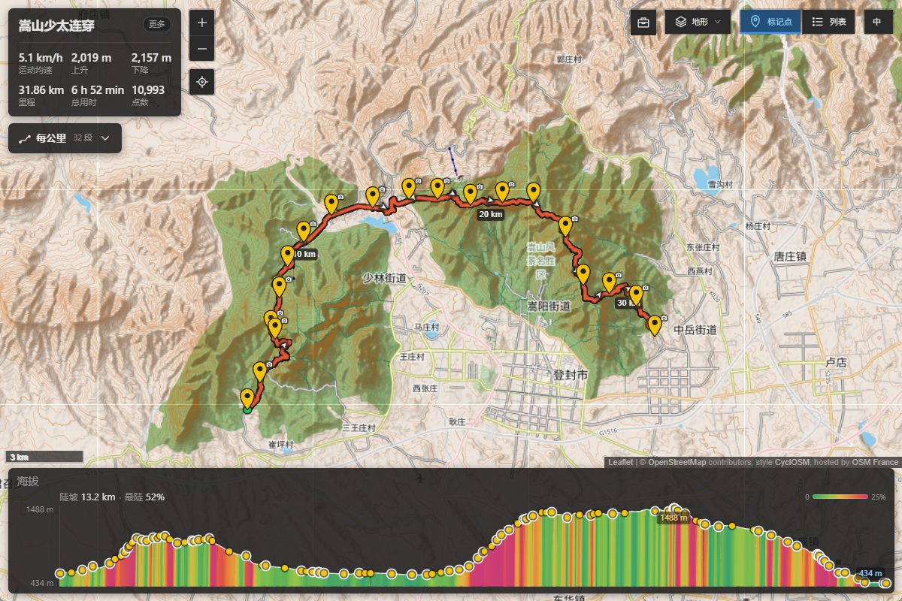

# QuickLook.Plugin.TrailViewer

简体中文 | [English](README.md)

在 Windows 上直接用 QuickLook 预览 GPX、KML、KMZ 和 FIT 轨迹。在资源管理器中选中轨迹文件并按
<kbd>Space</kbd>，无需打开地图软件即可查看路线、标记点、照片和海拔剖面。



## 快速开始

1. 从 [GitHub Releases](https://github.com/luluuuse/QuickLook.Plugin.TrailViewer/releases/latest) 下载最新
   `.qlplugin`。
2. 打开安装包完成安装，并从托盘完全退出后重新启动 QuickLook。
3. 在资源管理器中选中 `.gpx`、`.kml`、`.kmz` 或 `.fit` 文件，按 <kbd>Space</kbd>。

常用操作：

| 操作 | 控制 |
|---|---|
| 切换标记点 | <kbd>←</kbd> <kbd>→</kbd> 或 <kbd>A</kbd> <kbd>D</kbd> |
| 回到完整轨迹 | <kbd>C</kbd> |
| 显示/隐藏地图标记 | <kbd>W</kbd> |
| 切换底图 | <kbd>Q</kbd> / <kbd>E</kbd> |
| 隐藏界面 | <kbd>S</kbd> |
| 开始/结束测距 | <kbd>M</kbd> |
| 测距撤回 / 重做 | <kbd>Ctrl</kbd>+<kbd>Z</kbd> / <kbd>Ctrl</kbd>+<kbd>Shift</kbd>+<kbd>Z</kbd> |
| 查看轨迹天气 | 工具箱 → 轨迹天气 |
| 导出叠加图 | 工具箱 → 叠加图导出 |

## 功能概览

- **轨迹显示**：GPX 轨迹、KML LineString、`gx:Track` 和 FIT 活动/路线按段着色，方向箭头和公里标签随缩放自适应。
- **路线分析**：运动时间、数据缺口、GPS 异常跳点和基于 Naismith、Langmuir 下坡及陡上坡修正的用时估算。
- **每公里分段**：简介下方提供独立的折叠项，主动展开后逐公里显示经过时间和运动速度，并汇总总时间与运动时间；
  点击某一圈可在地图上聚焦并突出显示对应轨迹。一键切换详细模式可查看累计时间、上升/下降、平均心率、
  运动速度和垂直速度。
- **路网轨迹**：自动识别由多条独立路线合并成的路网，不把全网误算为一次行程；跳过全局速度、每公里表
  和合并剖面以降低加载时间与内存占用。
- **标记点与照片**：按路线顺序切换图钉，支持照片相册、真实原图像素比例显示、最高 800% 滚轮缩放与拖拽
  平移、速览列表，以及危险/水源/营地/下撤等本地语义提示。附件图片小弹窗复用标记点列表的半透明、
  无磨砂背景；照片全览外围也保持半透明，显示底层地图和轨迹。
- **海拔剖面**：坡度着色、航点位置、鼠标读数和跨窗口一致的垂直比例；逐点心率可按需叠加到独立纵轴，
  默认关闭，并用横虚线标出全程平均心率。
- **手动测距**：工具箱提供多段手动打点测距；右键添加点、左键拖动地图、滚轮缩放，靠近标记点或轨迹点时
  自动吸附。地图实时显示每段距离和总距离。
- **复制与附件导出**：轨迹摘要框可直接复制分享摘要；工具箱可复制起点、终点、顶点、地图中心或任意点的
  WGS-84 坐标，任意点在靠近标记点时自动吸附，并在提示与结果卡中备注点位海拔；还可将内置图片、
  Data URI 和 HTTPS 外链图片导出到轨迹旁。
- **信息聚焦**：打开轨迹和切换标记点时，地图会避开信息卡、工具栏、速览面板和剖面。
- **统一图标**：地图控件、工具面板、分段入口、速览、照片查看器和地图数据符号遵循同一套可复用图标规范；
  每公里数据列头保持纯文字。
- **响应式界面**：窄窗使用实测的 `inline`、`wrapped`、`docked` 三态布局，中英文切换，偏好持久化。
- **多图源底图**：路网保留 OpenStreetMap HOT，地形可在 CyclOSM、OpenHikingMap 和 OpenTopoMap 之间切换；
  配置个人密钥后可使用天地图路网和卫星图；定制类别提供独立的图源列表和编辑页，可管理 HTTPS 瓦片图源、
  自动识别两步路占位符与 512 px 地址。定制图源保存在宿主应用数据中，覆盖升级后仍会保留。图源面板只显示
  当前地图类型对应的来源；顶部入口显示当前类别图标和文字，低频的无底图模式使用标题栏中的网格图标。
- **统一工具箱**：距离测量、点位坐标、叠加图导出和附件图片导出组成 2×2 快捷图标格，轨迹天气保留为
  下方完整功能条。所有工具页共用右侧半透明窗口、标题栏、返回和关闭逻辑；叠加图导出也
  是其中一个页面。叠加图支持方版、竖版、横版 PNG，可选择墨色和底衬并实时预览；导出后窗口保持打开，
  可连续导出多种样式。图片自动写入路线名称与日期；
  路网文件只显示路线总长和轨迹段数，不伪造起终点或单次行程数据。附件导出可只快速复制内置图片，或
  三路并发处理全部图片。中断后重新导出同一轨迹会跳过已完成图片，只补导缺失或失败项。
- **统一浮动窗口**：工具箱、图层面板和标记点列表使用相同顶部位置与标题栏高度，三者互斥显示。
- **轨迹天气**：在浏览器中打开 Windy 并直接展开该点的逐小时天气预报。可选起点、终点或顶点，
  三者都定位到具体位置；文件没有可靠海拔时顶点分段禁用。Windy 默认打开云层，预览页不内嵌第三方地图。

完整操作、快捷键和导出说明见 [docs/USAGE.md](docs/USAGE.md)。

## 兼容范围

支持：

- GPX 1.0 / 1.1
- KML 2.2（含 `gx:Track` 和 `MultiGeometry`）
- 压缩的 `.kmz`
- 带 GPS 记录、压缩时间戳、海拔和路线点的 FIT 活动/路线

FIT 简要模式聚焦路线基础数据；记录的心率可按需叠加到剖面。步频、功率、温度、训练步骤和完整设备指标
暂不展示。

超过 20,000 个记录点的文件仍会绘制轨迹和起终点，但不再为每个采样点创建可点击标记。非法 XML 会显示
包含解析器原始错误信息的页面。单个输入文件最大为 64 MB。

## 隐私

插件不会把轨迹数据发送到服务器。打开文件时只在本地读取。选择在线或定制底图时会向对应瓦片服务
请求地图；**无底图模式** 由本地网格绘制。使用轨迹天气会把所选点坐标随链接发送给 Windy。偏好保存在
本机应用数据中，与带版本号的 WebView 缓存无绑定关系。

## 疑难处理

- 如果预览仍显示 XML 文本，请确认插件已安装并启用。
- 升级后界面没有变化时，请从托盘完全退出并重新启动 QuickLook。
- 在线瓦片空白时检查网络，或点击图层标题栏中的网格图标开启 **无底图模式**。
- <kbd>Esc</kbd> 归 QuickLook 管理；需要时使用预览关闭按钮。

更多诊断信息见 [docs/DEVELOPMENT.md](docs/DEVELOPMENT.md) 和 [docs/TESTING.md](docs/TESTING.md)。

## 开发

先阅读 [CONTRIBUTING.md](CONTRIBUTING.md)。主要文档：

- [架构](docs/ARCHITECTURE.md)
- [图标规范](docs/ICON_SYSTEM.md)
- [开发环境](docs/DEVELOPMENT.md)
- [测试](docs/TESTING.md)
- [发布](docs/RELEASING.md)
- [更新日志](CHANGELOG.md)

常用本地检查：

```text
npm ci
npm run check
dotnet build src/QuickLook.Plugin.TrailViewer.csproj -c Release
npm test
```

产品版本遵循 Semantic Versioning；WebView 缓存身份由前端内容生成，与发布版本号解耦。

## 致谢与许可证

本项目基于 [McBenac/QuickLook.Plugin.GpxViewer](https://github.com/McBenac/QuickLook.Plugin.GpxViewer)
二次开发，采用 MIT 许可证。上游版权声明原样保留在 [LICENSE](LICENSE) 中，并与本分支修改部分的版权
声明并列。
