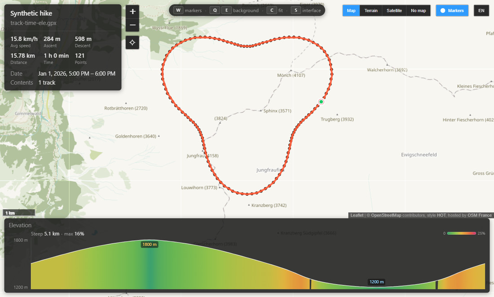

# QuickLook.Plugin.TrailViewer

简体中文 | [English](README.md)

在 Windows 上直接用 QuickLook 预览 GPX、KML 和 KMZ 轨迹。在资源管理器中选中轨迹文件并按
<kbd>Space</kbd>，无需打开地图软件即可查看路线、标记点、照片和海拔剖面。



## 快速开始

1. 从 [GitHub Releases](https://github.com/luluuuse/QuickLook.Plugin.TrailViewer/releases/latest) 下载最新
   `.qlplugin`。
2. 打开安装包完成安装，并从托盘完全退出后重新启动 QuickLook。
3. 在资源管理器中选中 `.gpx`、`.kml` 或 `.kmz` 文件，按 <kbd>Space</kbd>。

常用操作：

| 操作 | 控制 |
|---|---|
| 切换标记点 | <kbd>←</kbd> <kbd>→</kbd> 或 <kbd>A</kbd> <kbd>D</kbd> |
| 回到完整轨迹 | <kbd>C</kbd> |
| 显示/隐藏地图标记 | <kbd>W</kbd> |
| 切换底图 | <kbd>Q</kbd> / <kbd>E</kbd> |
| 隐藏界面 | <kbd>S</kbd> |
| 导出叠加图 | <kbd>X</kbd> / <kbd>Shift</kbd>+<kbd>X</kbd> |

## 功能概览

- **轨迹显示**：GPX 轨迹、KML LineString 和 `gx:Track` 按段着色，方向箭头和公里标签随缩放自适应。
- **路线分析**：运动时间、数据缺口、GPS 异常跳点和基于 Naismith、Langmuir 下坡及陡上坡修正的用时估算。
- **标记点与照片**：按路线顺序切换图钉，支持照片相册、速览列表和危险/水源/营地/下撤等本地语义提示。
- **海拔剖面**：坡度着色、航点位置、鼠标读数和跨窗口一致的垂直比例。
- **信息聚焦**：打开轨迹和切换标记点时，地图会避开信息卡、工具栏、速览面板和剖面。
- **响应式界面**：窄窗使用实测的 `inline`、`wrapped`、`docked` 三态布局，中英文切换，偏好持久化。
- **叠加图导出**：方版、竖版、横版 PNG，可选择墨色和底衬。

完整操作、快捷键和导出说明见 [docs/USAGE.md](docs/USAGE.md)。

## 兼容范围

支持：

- GPX 1.0 / 1.1
- KML 2.2（含 `gx:Track` 和 `MultiGeometry`）
- 压缩的 `.kmz`

超过 20,000 个记录点的文件仍会绘制轨迹和起终点，但不再为每个采样点创建可点击标记。非法 XML 会显示
包含解析器原始错误信息的页面。

## 隐私

插件不会把轨迹数据发送到服务器。打开文件时只在本地读取。选择在线底图时会向对应瓦片服务请求地图；
**无底图** 模式由本地网格绘制。偏好保存在本机应用数据中，与带版本号的 WebView 缓存无绑定关系。

## 疑难处理

- 如果预览仍显示 XML 文本，请确认插件已安装并启用。
- 升级后界面没有变化时，请从托盘完全退出并重新启动 QuickLook。
- 在线瓦片空白时检查网络，或切换到 **无底图**。
- <kbd>Esc</kbd> 归 QuickLook 管理；需要时使用预览关闭按钮。

更多诊断信息见 [docs/DEVELOPMENT.md](docs/DEVELOPMENT.md) 和 [docs/TESTING.md](docs/TESTING.md)。

## 开发

先阅读 [CONTRIBUTING.md](CONTRIBUTING.md)。主要文档：

- [架构](docs/ARCHITECTURE.md)
- [开发环境](docs/DEVELOPMENT.md)
- [测试](docs/TESTING.md)
- [发布](docs/RELEASING.md)
- [更新日志](CHANGELOG.md)

常用本地检查：

```text
npm ci
npm run check
dotnet build src/QuickLook.Plugin.TrailViewer.csproj -c Release
npm test
```

产品版本遵循 Semantic Versioning；WebView 缓存身份由前端内容生成，与发布版本号解耦。

## 致谢与许可证

本项目基于 [McBenac/QuickLook.Plugin.GpxViewer](https://github.com/McBenac/QuickLook.Plugin.GpxViewer)
二次开发，采用 MIT 许可证。上游版权声明原样保留在 [LICENSE](LICENSE) 中，并与本分支修改部分的版权
声明并列。
